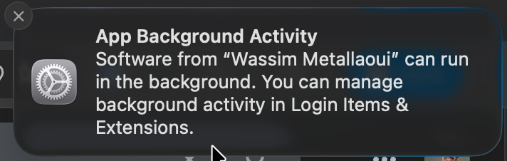

# zoom-autostatus

Automatically set your Slack status while you're in a Zoom meeting. Watches for Zoom meetings on your Mac and shells out to [st](https://github.com/wassimk/st) to set and clear your status.

## 💡 How It Works

Zoom runs a helper process called `CptHost` only while you're in a meeting. The tool checks for it every 5 seconds. When a meeting starts, it runs `st meeting`. When the meeting ends, it runs `st clear`.

It only clears a status it set. If you set `st lunch` and never join a Zoom meeting, your status is left alone.

## 🛠️ Install

Set up [st](https://github.com/wassimk/st) first. zoom-autostatus runs `st` for you, so `st` needs its tokens before this will work. At minimum, export `SLACK_PAT` from your shell startup file (`~/.zshrc` or `~/.zprofile` for zsh).

```shell
brew install wassimk/tap/zoom-autostatus
```

This will also install `st` as a dependency.

After installing, set it up as a background service:

```shell
zoom-autostatus install
```

That's it. Your Slack status will now change when you join and leave Zoom meetings.

## 💻 Usage

```
$ zoom-autostatus --help

Automatically set your Slack status while you're in a Zoom meeting

Usage: zoom-autostatus <COMMAND>

Commands:
  start      Run the Zoom meeting watcher in the foreground
  install    Install the LaunchAgent for automatic startup
  uninstall  Uninstall the LaunchAgent
  stop       Stop the background service
  restart    Restart the background service
  status     Show running state, meeting state, last st result, and log paths

Options:
  -h, --help     Print help
  -V, --version  Print version
```

Run the watcher in the foreground for testing:

```shell
zoom-autostatus start
zoom-autostatus start --verbose
```

Install as a LaunchAgent that starts automatically on login:

```shell
zoom-autostatus install
zoom-autostatus install --force   # overwrite existing
```

Remove the LaunchAgent:

```shell
zoom-autostatus uninstall
```

Check the current state:

```shell
zoom-autostatus status
```

## 🔑 Tokens

zoom-autostatus never reads or stores your tokens. It runs `st` through your login shell (`$SHELL -lic 'st meeting'`), so `st` sees the same `SLACK_PAT` your terminal does. The shell is recorded when you run `install`.

If your tokens live somewhere that prompts, like a password manager that asks for Touch ID, the background service can't answer the prompt and `st` will time out after 30 seconds.

## 📋 Logs

When running as a LaunchAgent, logs are written to:

- `~/Library/Logs/zoom-autostatus/stdout.log`
- `~/Library/Logs/zoom-autostatus/stderr.log`

## 🔧 Troubleshooting

Verify the service is running and see the result of the last `st` call:

```shell
zoom-autostatus status
```

Test the watcher interactively with verbose output, then join a Zoom meeting:

```shell
zoom-autostatus start --verbose
```

If `status` shows `st couldn't find SLACK_PAT`, export it from `~/.zshrc` or `~/.zprofile` and run `zoom-autostatus restart`.

If `st` isn't found, install it:

```shell
brew install wassimk/tap/st
```

## 📝 Good to Know

- If you already have a status when a meeting starts, like `st lunch`, the meeting status replaces it and is cleared when the meeting ends.
- `st clear` also ends Slack Do Not Disturb and clears your GitHub status, so anything you set there during a meeting is cleared when it ends.
- A failed `st` call is retried once. If it fails again, it waits for the next meeting.

## ⚠️ Background Activity Alert

After installing, macOS may show this one-time notification:


